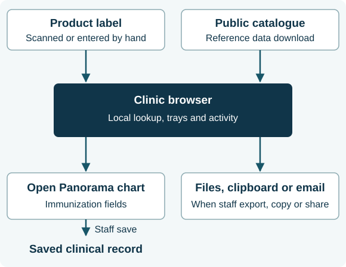

# Privacy assessment guide

Use this guide when assessing VaxLink for a clinic. It describes the 2.0 candidate workflow. Record the version and channel your clinic will install, the workflows you plan to use, and who will approve them. An inventory-only station has a different purpose from a station where staff also enter information in a client’s chart.

## Follow one scan

| From → to                         | What moves and why                                                                                                                                                                                                                                                                                                            |
| --------------------------------- | ----------------------------------------------------------------------------------------------------------------------------------------------------------------------------------------------------------------------------------------------------------------------------------------------------------------------------- |
| Product label → clinic browser    | The scanner sends the barcode text. Staff can also enter it by hand. VaxLink reads the product identifier (GTIN), lot, expiry and serial number when present. It can keep the original input, including a label scanned by mistake.                                                                                           |
| Public catalogue → clinic browser | VaxLink downloads the National Vaccine Catalogue over an encrypted connection to the Public Health Agency of Canada. It looks up the lot on the workstation. The agency receives an ordinary download request, including network information such as the clinic’s IP address. The request contains no scan or client details. |
| Browser → Inventory tray          | On an inventory station, product details stay in the browser profile for staff to review, count or export. An inventory scan does not enter a chart.                                                                                                                                                                          |
| Browser ↔ open Panorama chart     | In the Immunization workflow, VaxLink reads the available product and funding choices and checks the selected vaccine and lot. Depending on settings it also fills date, time, reason and consent. These values are linked to the client whose chart is open. Panorama can communicate with its own servers as fields change. |
| Reviewed chart → Panorama record  | Staff check the client, product, lot and clinical details, then save in Panorama. A tray count can decrease as soon as a fill is verified. Only the clinical record can confirm what was saved.                                                                                                                               |

VaxLink uses the staff member’s existing Panorama session. The browser allows it to read the supported immunization pages, including information visible on those pages. Choosing Inventory leaves that page access in place. Alpha can load on a supported production page, although it only fills training charts. Its field checks use the form and current page address to detect a change of chart or step. Its trays and activity records have no dedicated fields for client names, birth dates, health numbers or chart numbers.

A vaccine lot alone usually tells you little about a person. A rare product, scan time and workstation label together may identify a client or staff member when compared with appointments or shift records. A patient label scanned by mistake could identify someone directly.

## What stays on the workstation?

Local records are kept in the browser profile. VaxLink adds no encryption of its own to these stores. People with access to a shared profile, a copied profile or its backups may gain access to the information there.

| Record                           | What it contains                                                                                                                                                                                 | When it clears                                                                                                                                                                                                             |
| -------------------------------- | ------------------------------------------------------------------------------------------------------------------------------------------------------------------------------------------------ | -------------------------------------------------------------------------------------------------------------------------------------------------------------------------------------------------------------------------- |
| Immunization and Inventory trays | Original barcode, product name and identifier, lot, expiry, optional serial, scan time, quantity and lookup result. A reserved dose also carries information tying it to a browser tab and form. | Rows stay until used, removed or cleared. There is no age-based expiry for tray records.                                                                                                                                   |
| Held scans                       | Original scanner input, capture time, device and intended destination. These help staff account for interrupted or locked-workstation scans.                                                     | Kept for delivery or staff review. A storage limit can prevent new captures. Unlocking does not replay uncertain chart work.                                                                                               |
| Settings and scanner status      | Selected device, preferences, last capture, lock and unlock times, and browser tab or window references used for recovery. The profile also holds a copy of the public catalogue.                | Persist between sessions. Forgetting a scanner removes its pairing information. Other records have separate controls.                                                                                                      |
| Local Activity                   | Daily workflow and product counts, manufacturer categories, a device identifier and optional workstation label. Exports also give the times of first use, last activity and export.              | Kept across sessions until reset. Counts have no automatic age cutoff.                                                                                                                                                     |
| Recent chart lots and Debug      | Recent product and lot details. When Debug is on, the session also holds troubleshooting events such as funding choices, field checks and sometimes a vaccine barcode.                           | Cleared on browser restart. Turning Debug off clears its session details. Closing the popup leaves the session running. Packaged Alpha starts with Debug on, production with it off, unless staff have saved a preference. |

## When can a copy leave the profile?

VaxLink has no central scan or activity reporting service. The following staff actions create additional copies. Clearing the tray or resetting Activity leaves those copies under the control of their destination.

- **Download or copy.** An Inventory spreadsheet (CSV) includes the raw barcode. Local Activity and Debug have separate downloadable files. The Debug download includes the build and settings. Copying a held scan puts its barcode on the workstation clipboard.
- **Report a lot missing from the catalogue.** VaxLink opens an email draft to `NVC-CNV@phac-aspc.gc.ca`. It includes available product, GTIN, lot, expiry and catalogue version.
- **Report a lot missing from production Panorama.** When the catalogue recognizes the lot, staff can open a draft and choose their local Panorama Resolution Coordinator as recipient. The draft can also include manufacturer, drug identification number and funding search details. Training shows an explanation for this situation.
- **Review a draft.** Both drafts copy `innovation@wdgpublichealth.ca` by default. Staff can change recipients and decide whether to send. The mail service may already have saved the draft. A signature, attachment or chart screenshot can disclose more than the product details supplied by VaxLink.

## Decisions to record in your local PIA

| Decision                 | What to document                                                                                                                                                                                                                                                                  |
| ------------------------ | --------------------------------------------------------------------------------------------------------------------------------------------------------------------------------------------------------------------------------------------------------------------------------- |
| Purpose and authority    | Which programs will use Inventory, chart entry, Activity or Debug? Who is accountable? Identify applicable law, professional recordkeeping standards, permitted uses, and any notice or consent obligations.                                                                      |
| Access and safeguards    | Name the roles allowed to open charts, view trays, download files and receive support material. Check actual account access, disk encryption, screen locking, profile backups and download locations on the proposed stations. Include who can use a shared station after unlock. |
| Clinical accuracy        | Agree which defaults staff may use and how they check them. Autofill uses the time filling starts. Staff must verify the actual administration time and that consent was obtained, especially for historical entries. Record how staff correct a saved chart.                     |
| Disclosure and retention | Decide whether each export and default email recipient is appropriate. Set a retention period and disposal owner for trays, held scans, counts, downloads, backups and mail. Include older browser profiles when replacing a workstation.                                         |
| Requests and incidents   | Identify who handles access or correction requests, a lost device, a patient label scanned by mistake, or a file sent to the wrong recipient. Record how staff report the event and account for copies.                                                                           |
| Approval and review      | Keep the assessed version, workstation check results, remaining risks, responsible owners and approval in your local assessment. Revisit it when chart access, stored fields, recipients or clinic use changes.                                                                   |

The Office of the Privacy Commissioner of Canada’s fair information principles offer a reference for these questions. Your privacy lead can identify the rules that apply in your jurisdiction. [Fair information principles](https://www.priv.gc.ca/en/privacy-topics/privacy-laws-in-canada/the-personal-information-protection-and-electronic-documents-act-pipeda/p_principle/)

For supporting evidence, IT can check the software’s page access and storage against the installed version, verify the package, and test the proposed workstation with sample data. Local privacy and security approval depends on that deployment. [Architecture](architecture.md) · [Release and package verification](RELEASING.md) · [Workstation setup](workstation-setup.md) · [Security reporting](security.md)

The software description is based on the [2.0 candidate source reviewed for this guide](https://github.com/WDGPH/VaxLink/tree/e713f87ef6d1807499500632ea7035a3c34f9312). Record any additional security testing your organization requires for its deployment.
