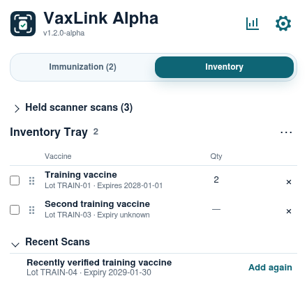
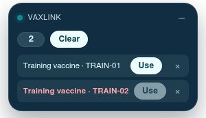
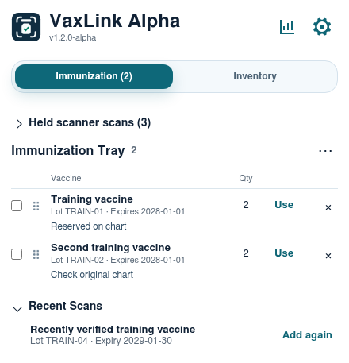
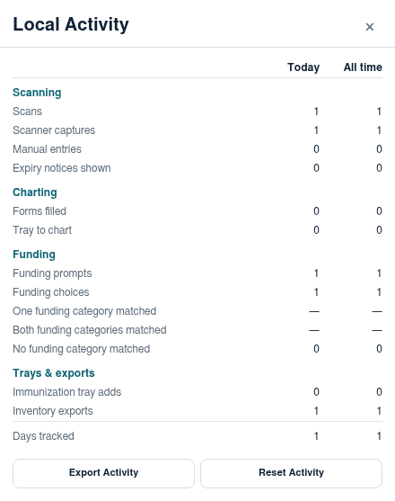

# Using the scanner

Use the clinic’s designated browser and profile. Open VaxLink and choose the workflow before scanning. If several Panorama tabs are open, select the intended chart and keep it visible while VaxLink fills it.

| Where you are working                                 | Where to look after a scan                                                                                                        |
| ----------------------------------------------------- | --------------------------------------------------------------------------------------------------------------------------------- |
| Inventory                                             | Open **Inventory** and check the tray. The same destination applies while the workstation is awake and locked.                    |
| Immunization with a ready single form                 | With automatic entry on, check the fields in the visible chart. Review the agent, lot and other fields before saving in Panorama. |
| Immunization with a ready Multiple Immunizations grid | Check the Immunization tray and the grid row. The tray keeps the dose for the detail step.                                        |
| Immunization while locked                             | After unlock, open **Immunization → Held scanner scans**. Unlocking leaves the chart alone.                                       |

With automatic entry off or no ready form, check the Immunization Tray. If a scan was held after a focus change, delayed response or extension update, open **Held scanner scans** for the next step. Check the original chart before using a scan that may have filled fields.

On a single form, a scan can be pending while VaxLink waits for Panorama to
settle. VaxLink keeps the barcode until it can verify the fields in that form.
You still need to check and save the record in Panorama.

The Inventory tray shows captured lots and recent scans.

## Choose the product barcode

Look beside the printed lot and expiry for the product barcode, often a small square GS1 DataMatrix. Another square code on the package may open a website. Scan only product labels. Check the product, formulation, lot and expiry shown in Inventory against the unit you will use.

If the unit label is hard to scan and your clinic allows a carton scan, keep the carton with its contents and compare the printed details on both. Enter the quantity separately. Scanning one carton cannot tell you how many doses remain.

## The scanner beeped but nothing appeared

1. Open VaxLink on the workstation where you scanned. Check the tray for the selected workflow and **Held scanner scans** in Immunization. The unlock summary shows scans available from the last lock.
2. If the chart may have changed, check its fields and saved record in Panorama. If a held scan still needs entry, select **Copy barcode** on its row and paste it into the **Barcode** field in VaxLink. Open the row’s **⋯** menu to view the full barcode or choose **Discard held scan** once you have accounted for that capture.
3. Open **Settings → Scanner**. Check the connection message and any last known capture time. A beep alone cannot confirm the workstation received the barcode. If the connection was interrupted, compare the expected doses with the scans you can account for.
4. If a save failed, reconcile the chart and local scans before rescanning. If a chart needs refreshing after a VaxLink update, check unsaved work first.

## The scan appeared, but chart entry is incomplete

| What staff see                                            | What to check next                                                                                                                                                                                                                                                                             |
| --------------------------------------------------------- | ---------------------------------------------------------------------------------------------------------------------------------------------------------------------------------------------------------------------------------------------------------------------------------------------- |
| Barcode is captured, but the lot or product is incomplete | Compare the label with the decoded fields. Check the catalogue status and last successful check in Settings. An unavailable catalogue cannot confirm a missing lot.                                                                                                                            |
| A working catalogue reports the lot missing               | Check the printed lot and product. If correct, review the catalogue email draft and its recipients before sending.                                                                                                                                                                             |
| The catalogue finds the lot, but Panorama does not        | Check Agent, formulation and funding. Training can have a limited lot list. For a production miss, contact the local Panorama Resolution Coordinator. In Multiple Immunizations, staff may need to delete the unfinished entry to complete the other entries. Check which entry is open first. |
| Only some chart fields filled                             | Read the message, check the original chart and complete the missing fields under local procedure. Confirm the correct client, product, lot, funding, administration details and consent before saving.                                                                                         |

When a lot appears in both funding categories, staff choose the category. A match in one category can guide the search. Staff still determine eligibility under the program’s rules.

## Use a saved dose

Choose **Use** for the vaccine you want. In the Multiple Immunizations grid,
VaxLink fills one row and keeps the dose in the tray. Select **Enter Details**
yourself. With **Carry a grid dose into Enter Details** on, VaxLink can bring
the same dose to the matching step. Choose the dose again if the row changed
or you switched away.

The chart tray also has a **Use** button beside each available vaccine.

Select rows to move them between trays. Drag a reorder handle or use its Up
and Down arrow keys to change the order. To add another dose from a recently
verified chart lot, choose it below the tray and confirm **Add to tray**.

## A tray dose is already in use

A reserved dose shows **Reserved on chart** in the popup and **In progress** on the chart. If **Check original chart** appears, open it and check the vaccine and lot on the original chart. Choose **Remove one from tray** if the chart accounts for that dose, or **Keep in tray** if the dose is still available. Choose **Not now** if you still need to check.

## Download troubleshooting details

In **Settings → Debug mode**, choose **Download** before closing the browser
or turning collection off. The file may include a scanned vaccine barcode.
Share it only through your clinic’s approved support process. Local Activity
shows usage counts and remains available after Debug is cleared.

For support, start with the software version, scanner model, training or production environment, package type, printed lot, catalogue status and exact message. Use a sample record for screenshots. Review any barcode, email recipients and Debug download before sharing through an approved private channel. [Privacy assessment guide](privacy-assessment.md)

## Move, test or replace the scanner

Choose **Disconnect** before moving the USB plug. Wait for the reader to stop. Moving a cable, hub or dock breaks its open connection. After reconnecting, check Settings. The browser may ask you to choose the scanner again.

Open **Scanner setup**, choose **Connect scanner**, then select the device. Setup closes and regular scanning continues. For an optional check, reopen setup and choose **Test saved scanner**. Samples stay out of trays and charts. Close setup to return to the previous capture setting. If two identical scanners are connected, unplug the extra one and choose again. For a cordless unit, test the handheld with its intended cradle.

Use **Forget** when retiring the device. Keep it plugged in so VaxLink can remove the browser permission. If it is already gone, follow the permission instructions in Settings.
