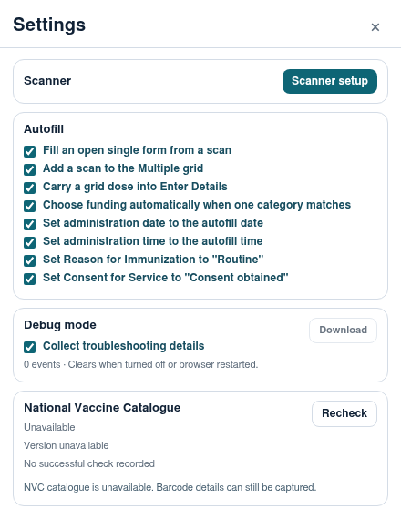
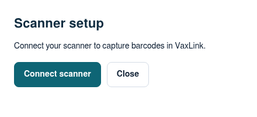

# Set up a scanning workstation

Designate one browser and one profile for scanning on each clinic workstation. Each browser profile and VaxLink installation has its own scanner connection and trays. Record the workstation configuration before staff start scanning.

| Record for this station                                | Local value |
| ------------------------------------------------------ | ----------- |
| Workstation identifier and Windows version             |             |
| Designated browser, version and profile                |             |
| VaxLink channel and version                            |             |
| Scanner model, handheld and cradle identifiers         |             |
| USB mode and VaxLink scanner profile                   |             |
| USB socket, hub or dock and power source               |             |
| Screen lock, sleep, hibernation and USB power settings |             |
| Tester, date and acceptance result                     |             |

1. Install the clinic channel in the designated profile. Keep training and development installations identifiable. Ordinary browser sync can install VaxLink on another computer. Tray items, held scans and pairing choices stay local to the installation.
2. Configure the scanner for USB serial capture. For the Zebra DS8178 cradle use USB CDC (virtual COM) and disable keyboard output. Scan a training barcode into a focused blank text editor. Characters appearing there indicate keyboard output is still enabled.
3. Open **VaxLink → Settings → Scanner → Scanner setup**. Choose **Connect scanner** and select the device. Wait for Settings to show **Connected**. Then scan into Inventory and confirm that the sample reaches this station’s tray.
4. Close the popup and run the lock procedure below on an awake workstation. Record the results against the actual model, cradle, browser and profile. Test sleep and wake separately.
5. If the clinic copies browser profiles, test a copied profile on its destination workstation, including the contents present immediately after the copy. If it uses remote desktops, verify where the USB device is attached, where the browser runs and where the scan is saved. Record each combination separately.

## Find the scanner controls

Open **Settings** using the gear in the popup. **Scanner setup** is at the top.

Choose **Connect scanner** to open the browser’s device chooser.

## Before clinical use

Confirm the station’s workflow and autofill settings with the clinical and privacy leads. Check the saved choices on the installed profile. The [privacy assessment guide](privacy-assessment.md) describes each switch and both diagnostic downloads.

Start in Inventory with representative products, formulations and package sizes. VaxLink recognizes nirsevimab as the Panorama agent RSVAb. Check each presentation against its label and the catalogue. In training, use synthetic records to try a single entry, several immunizations, an interrupted scan and a missing lot. Verify scan recovery after locking and unlocking the station. Ask an authorized Panorama administrator to confirm production lots and funding choices before clinical rollout.

[Workstation acceptance procedure](scanner-acceptance.md)
